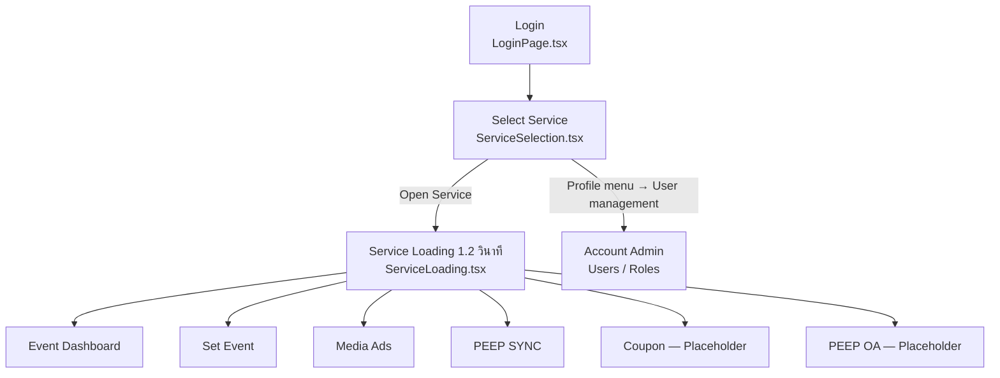
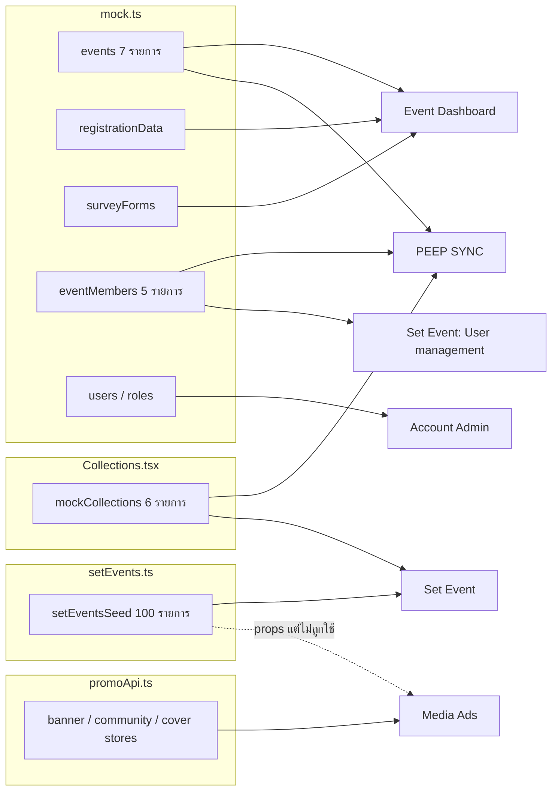

# 01 — ภาพรวมระบบและ Service

## 1. ภาพรวมระบบ

PEEP SHARE Admin เป็น Web Application สำหรับผู้ดูแลระบบภายใน (Internal Admin) ประกอบด้วยหลาย Service ที่เลือกเข้าใช้งานจากหน้า **Select Service** หลังเข้าสู่ระบบ

**สถาปัตยกรรม Frontend (ยืนยันจาก Source Code)**

| หัวข้อ | รายละเอียด | หลักฐาน |
|---|---|---|
| Framework | React 19, Vite 8, Tailwind CSS v4, TypeScript | `package.json` |
| Routing | ไม่มี Router — ใช้ State `screen` ใน `App.tsx` และ State `activeNav`/`view` ในแต่ละ Service | `src/App.tsx` |
| State Management | React `useState`/`useRef` ภายใน Component ไม่มี Global Store (ยกเว้น `LanguageProvider`) | ทุก View |
| Data | Mock/Seed ใน `src/data/` และ Inline Array ใน Component | `src/data/mock.ts`, `setEvents.ts`, `appBanners.ts`, `mock/promoApi.ts` |
| Persistence | เฉพาะภาษา (`localStorage`) | `src/i18n/index.tsx` |
| i18n | EN/TH ใช้ข้อความภาษาอังกฤษเป็น Key, ไม่พบคำแปลจะแสดงภาษาอังกฤษ | `src/i18n/index.tsx` |
| Library ภายนอกที่ทำงานจริง | `qrcode` (สร้าง QR PNG ฝั่ง Client), `@iconify/react` | `src/components/set-event/qr.tsx` |

## 2. ตาราง Service

| Service ID (`mock.ts`) | ชื่อที่แสดง | บทบาทที่แสดงบน UI | เมนูหลัก | สถานะ Implementation |
|---|---|---|---|---|
| — | Login / App Shell | — | Login, Select Service, Header | พัฒนาแล้วใน Frontend (Authentication จำลอง) |
| `event-dashboard` | Event Dashboard | Data Viewer (Hardcode) | Event List → Event Detail (แท็บ Registration, Survey) | พัฒนาแล้วบางส่วน |
| `set-event` | Set Event | Super Admin (ค่าเริ่มต้น) | Event List, Regis Form, Survey Form, Cloud Management, Collections, Activity Log | พัฒนาแล้วใน Frontend (ส่วนใหญ่ — Local State) |
| `media-ads` | Media Ads | Super Admin (ค่าเริ่มต้น) | Set Banner in App (Home page, Community page), Set Cover Page in App | พัฒนาแล้วใน Frontend (ผ่าน Mock API จำลอง Latency) |
| `peep-sync` | PEEP SYNC | Photographer (Hardcode) | Event List, Cloud Management, Collections, Photo Sync | พัฒนาแล้วบางส่วน (Photo Sync และ Cloud เป็น Mock) |
| `coupon` | Coupon | — | — | ยังไม่ได้พัฒนา (Placeholder) |
| `peep-oa` | PEEP OA | — | — | ยังไม่ได้พัฒนา (Placeholder) |
| — | Account Admin (User Management) | Super Admin (ค่าเริ่มต้น) | Users, Roles & Permissions | พัฒนาแล้วบางส่วน (บันทึกไม่ได้หลายส่วน) |

> ทุก Service ใน `mock.ts` มี `environment: 'Production'` ดังนั้น UI แบบ "Staging" (`ServiceCard.tsx`, `ServicePlaceholder.tsx`) ไม่ปรากฏกับข้อมูลปัจจุบัน

## 3. รายละเอียดราย Service

### 3.1 AUTH — Login และ App Shell

- **วัตถุประสงค์:** เข้าสู่ระบบ เลือก Service เปลี่ยนภาษา ออกจากระบบ
- **หน้าจอ:** `LoginPage.tsx` (แท็บ Username Login / QR Code Login), `ServiceSelection.tsx`, `ServiceLoading.tsx`, `ServicePlaceholder.tsx`, `components/Header.tsx`, `components/Sidebar.tsx`
- **ข้อเท็จจริงสำคัญ:**
  - ฟอร์มเบอร์โทร + รหัสผ่านใช้เพียง HTML `required` แล้วเรียก `onLogin()` ทันที ไม่มีการตรวจสอบ Credential
  - QR Login แสดงไอคอนแทน QR จริง มีปุ่ม "Simulate Scan" และรหัสยืนยันคงที่ `831106`
  - "Remember me", "Forgot Password?" ไม่มีผลใดๆ
  - เมนูโปรไฟล์ "User Profile" ไม่มี Handler ในทุก Service
  - เมนู "User management" แสดงเฉพาะหน้า Select Service และหน้า Account Admin
  - Log Out ล้าง State `isAuthenticated` เท่านั้น
- **Dependencies:** ทุก Service

### 3.2 DASH — Event Dashboard

- **วัตถุประสงค์ (จาก Comment ในโค้ด):** "Event Dashboard is for Data Viewers only: the Event List, then each event's data." (`EventDashboardApp.tsx`)
- **หน้าจอ:** Event List (`EventList.tsx` โหมด `dashboard`), Event Detail (`EventDetail.tsx` แสดงเฉพาะแท็บ Registration, Survey)
- **ทำงานได้:** ค้นหา, กรองสถานะ, เรียงลำดับ (ยกเว้นวันที่), แบ่งหน้า, ดูข้อมูลผู้ลงทะเบียน, ดูผลแบบสำรวจ, **Export ผลแบบสำรวจเป็น CSV/XLS ได้จริง**
- **ไม่ทำงาน:** Export ข้อมูลผู้ลงทะเบียน (ปุ่ม CSV/Excel ไม่มี Handler), Sort ตามวันที่
- **ข้อมูล:** `events`, `registrationData`, `surveyForms` จาก `src/data/mock.ts` (ข้อมูลชุดเดียวกับ PEEP SYNC แต่ **คนละชุด** กับ Set Event)

### 3.3 SYNC — PEEP SYNC

- **วัตถุประสงค์ (จาก `mock.ts`):** "Photographer workspace to view assigned events and upload, sync, and manage event photos in the cloud."
- **หน้าจอ:** Event List (มีคอลัมน์ Actions), Event Detail (แท็บ Overview, Registration, Survey, Collections, Members & Access), Cloud Management, Collections (รายการ / รายละเอียด / แชร์), Photo Sync (`PhotoManagement.tsx`)
- **ทำงานได้:** สร้าง Collection, ดูไฟล์ (Mock) พร้อมค้นหา/กรอง/แบ่งหน้า/เลือก, แชร์ (ตั้งค่า Sharing, คัดลอกลิงก์, ดาวน์โหลด QR PNG จริง), จัดการผู้มีสิทธิ์, ลบ Collection, จัดการสมาชิก Event (Local State)
- **จำลอง/ไม่ทำงาน:** อัปโหลดไฟล์, Photo Sync ทั้งหน้า, Cloud Upgrade/Manage, ปุ่ม Edit/Access ใน Event List, Bulk Download/Delete
- **หมายเหตุ:** ไม่มีการกรอง "Event ที่ได้รับมอบหมาย" — แสดงทุก Event รวม Draft

### 3.4 EVENT / EFORM / COMM / TPL — Set Event

- **วัตถุประสงค์ (จาก `mock.ts`):** "Configure and manage event settings, information, and event structure."
- **หน้าจอ:**
  - Event List (`SetEventList.tsx`) — แท็บ All/Mine/Published/Draft/Private/Trash, ค้นหา, กรอง, Sort, Pagination 10 รายการ
  - Create/Edit Event (`EventFormPage.tsx`) — 4 Step, 8 Section, Status & Visibility Panel, Preview
  - Event Workspace (`EventWorkspaceSidebar.tsx`) — Overview, Event Detail, Collection, QR Code / Scanner, User management, Activity logs
  - Regis Form / Survey Form (`FormLibrary.tsx`) — Template Library
  - Cloud Management, Collections (ใช้ Component เดียวกับ PEEP SYNC)
  - Activity Log ระดับระบบ (`ActivityLog.tsx`) — **ใช้ข้อมูล Mock ของ Event Dashboard ไม่ใช่ของ Set Event**
- **ทำงานได้:** สร้าง/แก้ไข/ทำซ้ำ/ย้ายไปถังขยะ/ลบถาวร Event, Validation 2 ระดับ (Draft/Complete), วงจร Draft → Pending → Published/Private/Scheduled, ลิงก์ Collection, สร้าง/ลบ QR Link พร้อม QR PNG จริง, Activity Log ระดับ Event (บันทึก Diff), Template CRUD, Broadcast Automation (เก็บค่า ไม่ส่งจริง)
- **ข้อจำกัด:** ข้อมูลหายเมื่อออกจาก Service หรือ Refresh, ไม่มีการเผยแพร่อัตโนมัติตาม `scheduledAt`, User management ใน Event เป็นข้อมูลชุดเดียวกันทุก Event, System Settings เข้าถึงไม่ได้

### 3.5 MEDIA — Media Ads

- **วัตถุประสงค์:** "Manage in-app banners and cover pages shown in the Peep Share app."
- **หน้าจอ:** 3 Placement ใช้ Component ชุดเดียวกัน (`PromoManager`, `PromoList`, `PromoForm`, `PromoSort`, `PromoPreview`)
  - Home page banner (ขนาดแนะนำ 1432 × 480 px)
  - Community page banner (ขนาดแนะนำ 1432 × 480 px)
  - Cover Page (ขนาดแนะนำ 1080 × 1440 px — **เป็นสมมติฐานในโค้ด** มีหมายเหตุ "No Cover Page spec exists in this project yet")
- **ทำงานได้:** List (ค้นหา, 4 Filter + ช่วงวันที่), สร้าง/แก้ไข/ทำซ้ำ/Activate/Deactivate/ลบ, จัดลำดับ (Drag & Drop + ปุ่มลูกศร), Preview, Unsaved-changes Guard
- **ข้อมูล:** ผ่าน `src/data/mock/promoApi.ts` ซึ่งระบุว่า "MOCK ONLY — ... the signatures are the contract" — จำลอง Latency ด้วย `setTimeout` และเก็บในหน่วยความจำ (คงอยู่ระหว่าง Service ได้ แต่หายเมื่อ Refresh)

### 3.6 ADMIN — Account-level User Management

- **เข้าถึงจาก:** เมนูโปรไฟล์ → "User management" (เฉพาะหน้า Select Service)
- **หน้าจอ:** Users (`UserManagement.tsx`) — รายการ, รายละเอียดผู้ใช้; Roles & Permissions (`RoleManagement.tsx`) — รายการ Role, Permission Matrix
- **ทำงานได้:** ค้นหา/กรองผู้ใช้, Suspend/Reactivate (Local State, หายเมื่อเปลี่ยนเมนู), ติ๊ก Permission (ไม่บันทึก)
- **ไม่ทำงาน:** Add User, Edit User, Delete User, Create Role (ปุ่มปิด Modal โดยไม่บันทึก), Save Permission, View Users
- **ไม่มีการบังคับใช้สิทธิ์ใดๆ ในระบบ**

## 4. กลุ่มผู้ใช้งานและบทบาท

| บทบาท | หลักฐานในโค้ด | การบังคับใช้ |
|---|---|---|
| Super Admin | ค่าเริ่มต้นของ `Header`/`Sidebar` (`userRoleLabel = 'Super Admin'`), `roles` ใน `mock.ts` | ไม่มี |
| Data Viewer | `EventDashboardApp.tsx` (`ROLE_LABEL`), `roles` | ไม่มี — จำกัดแท็บด้วย Hardcode `EVENT_TABS` |
| Photographer | `PeepSyncApp.tsx`, `roles` | ไม่มี — เห็นแท็บ Registration/Survey ได้ |
| Event Admin, Event Staff, Viewer | `roles`, `RoleType` ใน `mock.ts`, ตัวเลือกใน Members & Access | ไม่มี |

ชื่อผู้ใช้ที่แสดง `@suchada.t` และ Avatar `ST` เป็นค่า Hardcode ส่วน "Author" ของ Set Event คือ `CURRENT_AUTHOR = 'Suchadas'` ซึ่ง **ไม่เชื่อมกับผู้ใช้ที่ Login** (`src/data/setEvents.ts`)

## 5. ความสัมพันธ์ระหว่าง Service และข้อมูล

ประเด็นที่ต้องให้ PM/Dev ยืนยัน: ระบบมี **ข้อมูล Event สองชุดที่ไม่เชื่อมกัน** (`events` ใน `mock.ts` สำหรับ Event Dashboard/PEEP SYNC และ `setEventsSeed` สำหรับ Set Event) — ดู `Q-001` ใน [07-dev-qa-handoff.md](07-dev-qa-handoff.md)
