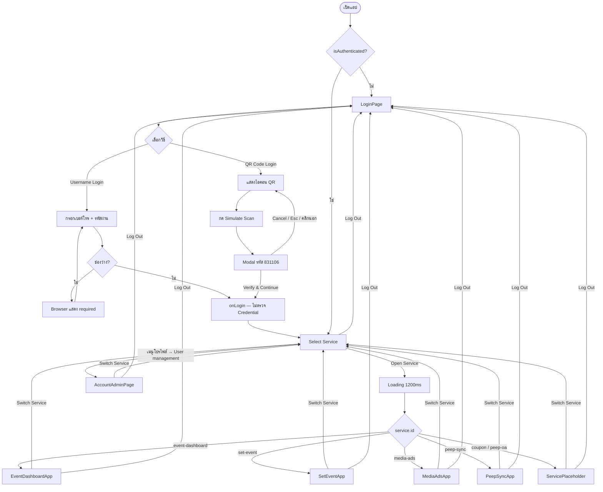
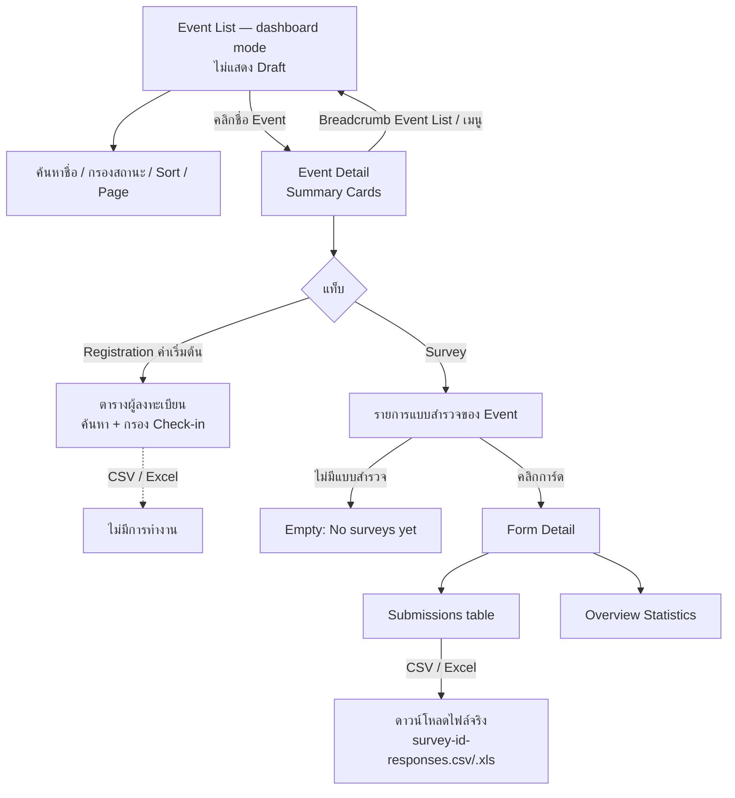
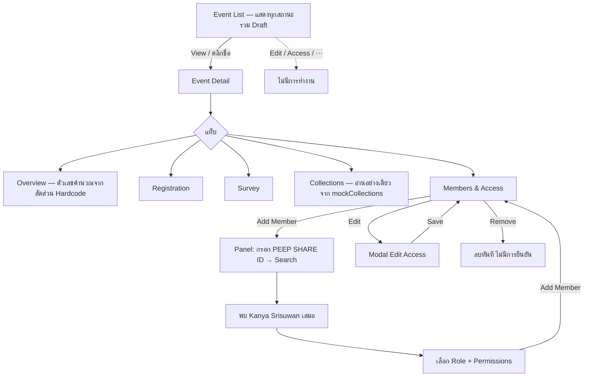
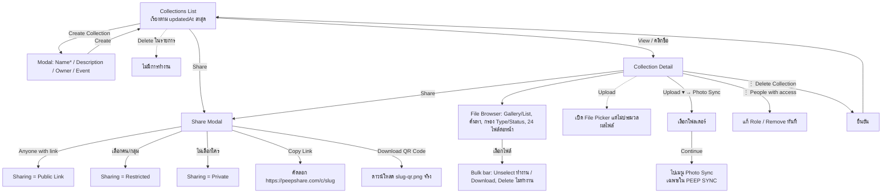
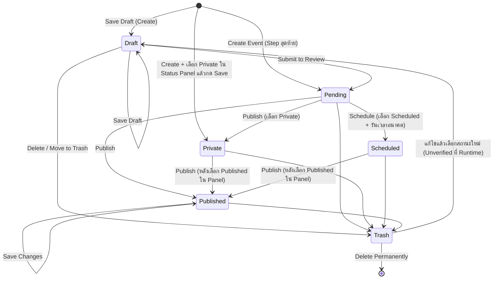
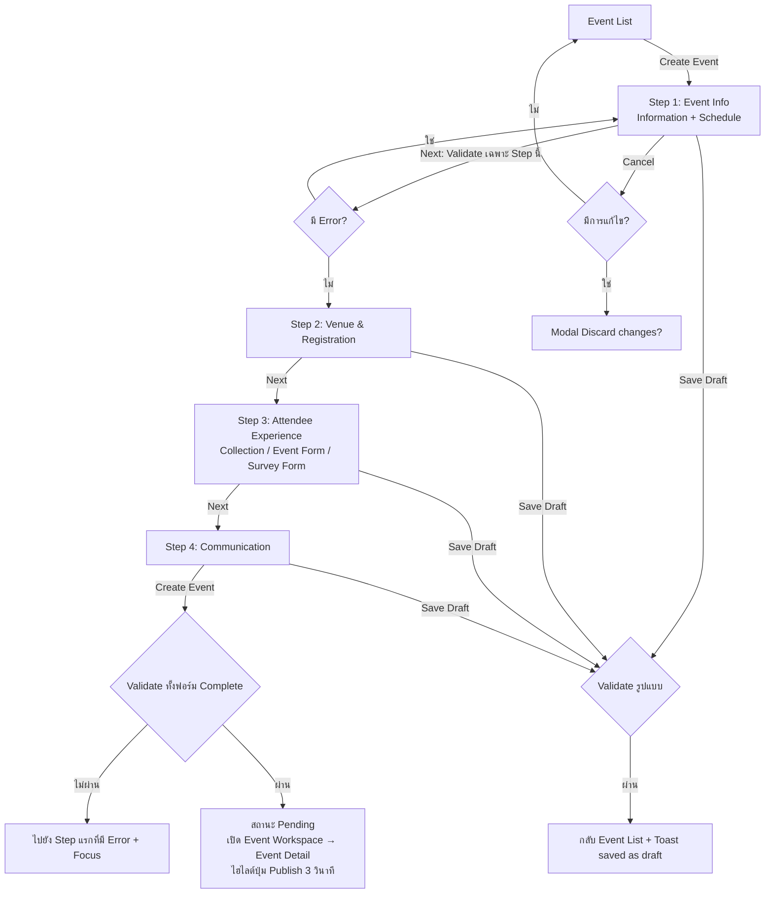
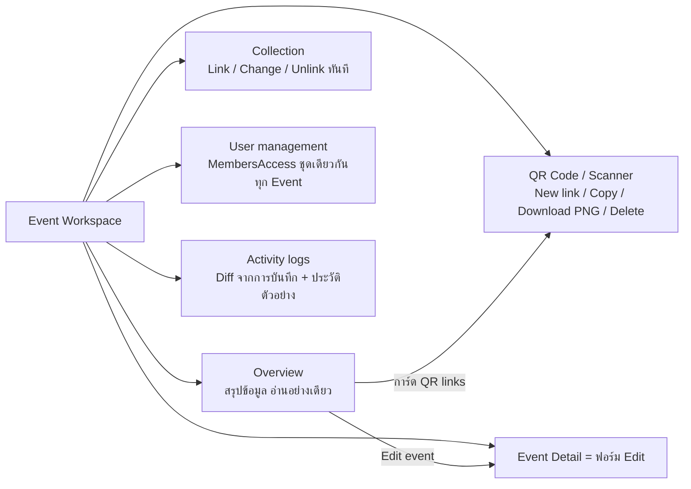
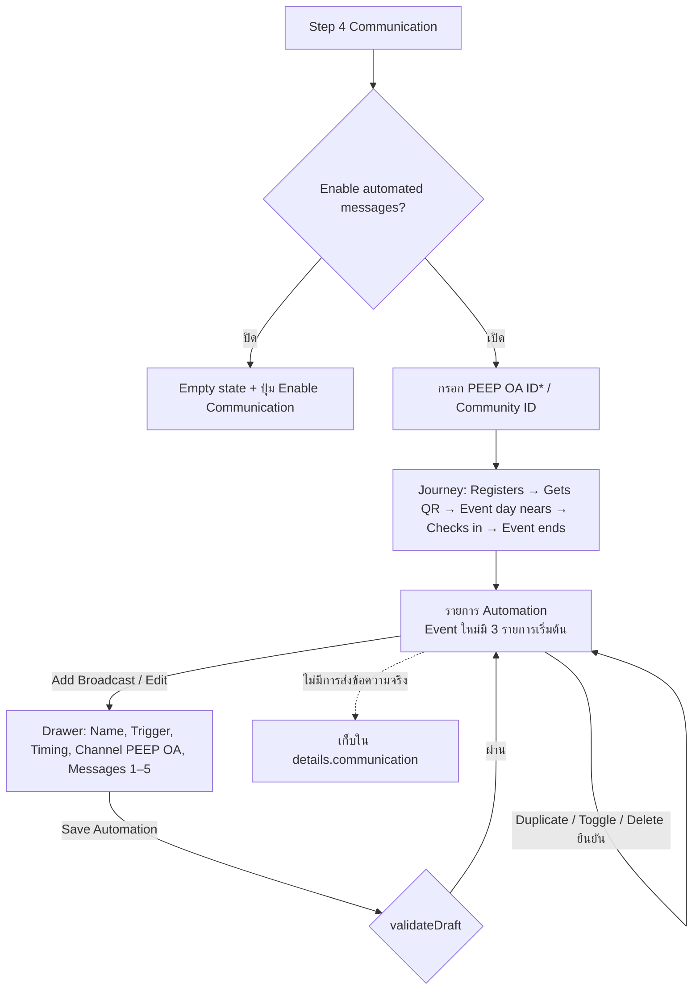
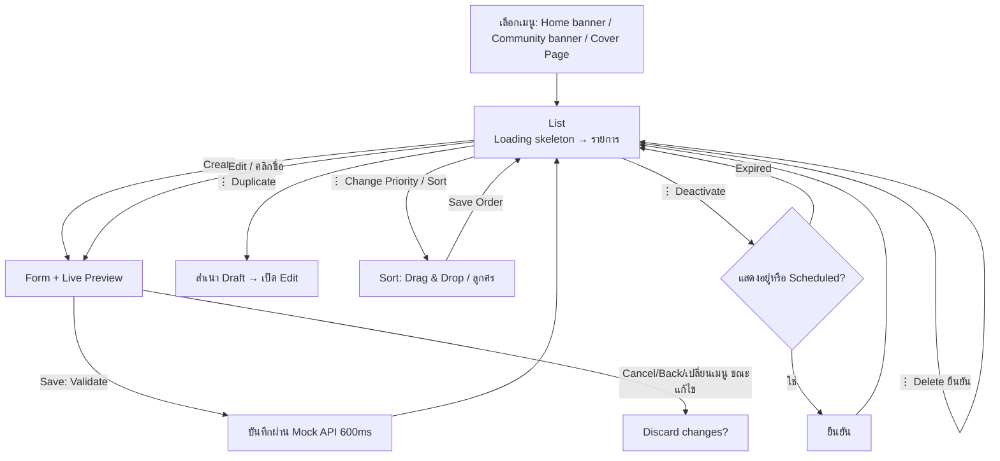
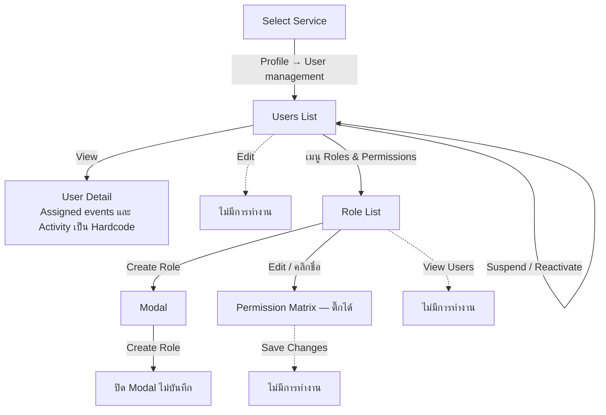

# 02 — User Flows

รูปแบบ: `Service → Page → User Action → System Response → Data Dependency → Result`
ทุก Flow อ้างอิงจาก Source Code หากเป็นการจำลองจะระบุไว้

---

## 1. AUTH — เข้าสู่ระบบและเลือก Service



| ขั้น | User Action | System Response | Data Dependency | Result |
|---|---|---|---|---|
| 1 | กรอกเบอร์โทรและรหัสผ่าน กด Log In | ตรวจเฉพาะ HTML `required` แล้วตั้ง `isAuthenticated=true` | ไม่มี | เข้าหน้า Select Service |
| 2 | กด Open Service | แสดง Loading 1.2 วินาที (`setTimeout`) | `services` ใน `mock.ts` | เปิด Service |
| 3 | เปลี่ยนภาษา (หน้า Login หรือ Header) | เปลี่ยนภาษาทันที บันทึก `localStorage` | `peepshare.lang` | ภาษาคงอยู่หลัง Refresh |
| 4 | Log Out | `isAuthenticated=false` | — | กลับหน้า Login (State ของ Service ถูก Unmount) |

**จุดที่ไม่มี:** การจัดการ Session หมดอายุ, การล็อกบัญชี, ข้อความ Credential ผิด, Forgot Password Flow

---

## 2. DASH — Event Dashboard



| ขั้น | User Action | System Response | Data | Result |
|---|---|---|---|---|
| 1 | เปิด Event List | กรอง Draft ออก, แสดง 6 Event, คอลัมน์ Check-ins | `events` | รายการ Event |
| 2 | คลิกชื่อ Event | แสดง Event Detail แท็บ Registration | `events`, `registrationData` | ข้อมูลผู้ลงทะเบียนของ Event |
| 3 | เลือกแท็บ Survey → การ์ดฟอร์ม | แสดง Submissions | `surveyForms` | ตารางคำตอบ |
| 4 | กด CSV / Excel ใน Submissions | สร้าง Blob และดาวน์โหลด | Submissions ของฟอร์ม | ไฟล์ CSV (UTF-8 BOM) หรือ XLS (HTML Table) |

---

## 3. SYNC — PEEP SYNC

### 3.1 Event และ Members



### 3.2 Collections



### 3.3 Cloud Management และ Photo Sync

- **Cloud Management:** แสดงค่าคงที่ (28.5 / 100 GB) ค้นหาตาราง "Storage Usage by Event" ได้ ปุ่ม Upgrade/Manage ทั้งหมดไม่ทำงาน
- **Photo Sync (`PhotoManagement.tsx`):** เลือก Event จาก Dropdown → แสดงตัวเลขคำนวณจากสัดส่วน Hardcode, Progress 94% คงที่, ขั้นตอน Workflow เป็นภาพนิ่ง ปุ่มทั้งหมดไม่ทำงาน

---

## 4. EVENT / EFORM — Set Event

### 4.1 วงจรชีวิต Event (Status Lifecycle)



> หมายเหตุ: ไม่มีกลไกเปลี่ยน `Scheduled` → `Published` อัตโนมัติเมื่อถึง `scheduledAt` (ไม่มีโค้ดที่ใช้ค่านี้)
> การเปลี่ยนสถานะบางเส้นทาง (เช่น Published → Draft ผ่าน Status Panel) อนุญาตใน UI แต่ไม่มีการระบุ Business Rule — ดู `Q-010`

### 4.2 สร้าง Event (Create)



### 4.3 แก้ไขและเผยแพร่ (Edit / Publish)

| ขั้น | User Action | System Response | Data | Result |
|---|---|---|---|---|
| 1 | กดชื่อ Event หรือไอคอน Edit | เปิด Workspace (Overview หรือ Event Detail) | `events` state | Workspace ของ Event |
| 2 | แก้ไข Step ใดก็ได้ (กระโดดข้าม Step ได้ใน Edit) | ไม่ Validate ตอนกด Next | — | — |
| 3 | กด Submit to Review (Draft) | Validate Complete → สถานะ Pending | — | ไฮไลต์ปุ่ม Publish |
| 4 | กด Publish (Pending/Private/Scheduled) | Validate Complete → Published / Private / Scheduled | — | กลับ Event List + Toast |
| 5 | กด Save Changes (สถานะอื่น) | Validate Complete ตามสถานะที่เลือกใน Panel | — | กลับ Event List + Toast "updated" |

### 4.4 Event Workspace



### 4.5 ทำซ้ำ / ลบ

| Action | System Response | Result |
|---|---|---|
| Duplicate (ไม่ใช่ Trash) | สร้างสำเนา ID ใหม่ ชื่อ "(Copy)" สถานะ Draft ล้าง registrants, qrLinks, scheduledAt, password | แทรกต่อจากต้นฉบับ, ไฮไลต์ "NEW" 4 วินาที, Toast |
| Delete (ไม่ใช่ Trash) | Modal "Move event to Trash?" | สถานะ Trash, บันทึก Activity "Moved to Trash", **ไม่มี Toast** |
| Delete (Trash) | Modal "Delete event permanently?" | ลบออกจากรายการ, **ไม่บันทึก Activity, ไม่มี Toast** |

---

## 5. COMM — Broadcast Automation



---

## 6. TPL — Template Library (Regis Form / Survey Form)

```mermaid
flowchart TD
    L[รายการ Template ตามประเภท] -- ค้นหา --> L
    L -- Create Template --> E[Drawer Edit]
    L -- View / คลิกชื่อ --> V[Drawer View: Fields, Used in events]
    V -- คลิก #id ชื่อ Event --> EV[เปิด Event → Event Detail]
    V -- Edit Template --> E
    V -- Duplicate --> E2[สำเนา (Copy) เปิดใน Edit]
    E -- Save: Validate --> V
    L -- Delete ยืนยัน --> L
    T[ฟอร์ม Event: Use Template] -. คัดลอก ไม่ผูก .-> L
```

---

## 7. MEDIA — Media Ads



สถานะที่แสดง (คำนวณทุกครั้งที่ Render): `draft` → Draft, `inactive` → Inactive, Schedule ก่อนเริ่ม → Scheduled, Schedule เลยวันสิ้นสุด → Expired, อื่นๆ → Active

---

## 8. ADMIN — User Management


