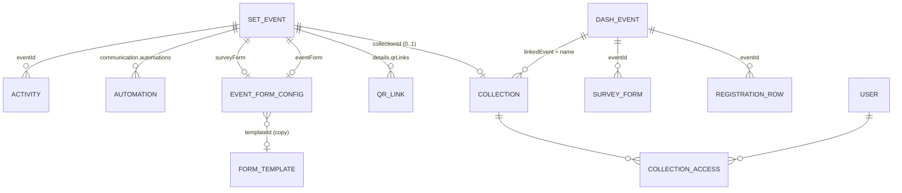

# 05 — Business Rules และข้อกำหนดข้อมูล

**แหล่งที่มาของกฎ** (คอลัมน์ "แหล่ง")
- **Code** = ยืนยันได้จาก Source Code
- **Doc** = อ้างอิงจากเอกสารเดิม (`Design.md` หรือ Spec ใน `src/imports/pasted_text/`) — ยังไม่มีในโค้ด
- **PM/Dev** = รอยืนยันจาก PM/Dev

> ⚠️ กฎทั้งหมดที่เป็น **Code** คือ **Frontend Validation เท่านั้น** ห้ามอนุมานว่าเป็น Database Constraint หรือ Backend Validation — Backend ต้องกำหนดและ Validate ซ้ำ

---

## 1. กฎทั่วไปของระบบ (Cross-cutting)

| ID | กฎ | แหล่ง | หลักฐาน |
|---|---|---|---|
| BR-AUTH-001 | ผู้ใช้ที่ยังไม่เข้าสู่ระบบจะเห็นเฉพาะหน้า Login ไม่ว่า State หน้าจอเป็นอะไร | Code | `App.tsx` |
| BR-AUTH-002 | การเข้าสู่ระบบไม่ตรวจ Credential (จำลอง) | Code | `LoginPage.tsx` |
| BR-AUTH-003 | ภาษาที่รองรับ: `en`, `th`; ค่าเริ่มต้น `en`; จดจำใน `localStorage['peepshare.lang']` | Code | `i18n/index.tsx` |
| BR-AUTH-004 | ไม่มีการตรวจสิทธิ์เข้าถึง Service/Feature ใดๆ | Code | `App.tsx`, ค้นหาทั้ง `src/` |
| BR-AUTH-005 | โมเดลสิทธิ์ 2 ชั้น: (1) Event Access — ผู้ใช้เข้าถึง Event ได้หรือไม่ (2) Feature Permission — ทำอะไรได้ใน Event | Doc | `Design.md` §22 |
| BR-AUTH-006 | ข้อมูลทั้งหมดอยู่ใน Memory ของเบราว์เซอร์; Set Event/PEEP SYNC/Account Admin หายเมื่อออกจาก Service; Media Ads คงอยู่จน Refresh | Code | `useState` ในแต่ละ App, `promoApi.ts` |
| BR-AUTH-007 | เวลาทั้งหมดเป็นเวลาท้องถิ่นของเบราว์เซอร์ รูปแบบ `YYYY-MM-DDTHH:mm` ไม่มี Timezone | Code | `setEvents.ts`, `appBanners.ts` (`nowLocal`) |
| BR-AUTH-008 | Timezone ที่ใช้จริง (เช่น Asia/Bangkok) | PM/Dev | `Q-019` |

---

## 2. Event Dashboard และ PEEP SYNC (`data/mock.ts`)

### 2.1 สถานะ Event (ชุดข้อมูล `events`)

`EventStatus = 'Draft' | 'Upcoming' | 'Ongoing' | 'Completed' | 'Archived'`

| ID | กฎ | แหล่ง |
|---|---|---|
| BR-DASH-001 | Event Dashboard ไม่แสดง Event สถานะ Draft; PEEP SYNC แสดงทุกสถานะ | Code (`EventList.tsx`) |
| BR-DASH-002 | ไม่มีการเปลี่ยนสถานะ Event ใน UI ของสองระบบนี้ | Code |
| BR-DASH-003 | ความหมายและเงื่อนไขการเปลี่ยน Upcoming → Ongoing → Completed → Archived | PM/Dev (`Q-001`) |
| BR-DASH-004 | Attendance % = round(checkedIn / registrants × 100) แสดงเมื่อ registrants > 0 | Code (`EventDetail.tsx`) |
| BR-DASH-005 | Survey Response Rate (Overview PEEP SYNC) = round(surveyResponses / checkedIn × 100) | Code |
| BR-DASH-006 | ค่าเฉลี่ย Rating นับเฉพาะค่าตัวเลขที่ > 0 | Code (`SurveyFeedback.tsx`) |
| BR-DASH-007 | สถานะฟอร์มแบบสำรวจ `Active` แสดง "Enabled" ค่าอื่นแสดง "Disabled" | Code |
| BR-DASH-008 | Export ได้เมื่อมีคำตอบ ≥ 1 | Code |
| BR-DASH-009 | Registration Data ควรเป็น Dynamic Columns ตามฟอร์มของแต่ละ Event และรองรับ Export CSV/Excel | Doc (`Design.md` §14) |
| BR-DASH-010 | สัดส่วน General/VIP (72/28), Photo Completed/Processing (99%/0.7%), Event Team counts เป็นค่าคงที่จำลอง **ไม่ใช่ Business Rule** | Code (ต้องแทนด้วยข้อมูลจริง) |

### 2.2 สมาชิก Event (Members & Access)

| ID | กฎ | แหล่ง |
|---|---|---|
| BR-SYNC-001 | Role ที่กำหนดให้สมาชิก Event ได้: Event Admin, Event Staff, Photographer, Viewer (ไม่มี Super Admin, Data Viewer) | Code (`MembersAccess.tsx` `ROLES`) |
| BR-SYNC-002 | Permission ของสมาชิก (9): View Event, View Photos, Upload Photos, Sync Photos, View Registration, View Survey, View Reports, Export Data, Manage Members | Code |
| BR-SYNC-003 | ค่าเริ่มต้นสมาชิกใหม่: Role Viewer, Permission ["View Event"], Status Active | Code |
| BR-SYNC-004 | การเลือก Role ไม่ตั้ง Permission อัตโนมัติ | Code |
| BR-SYNC-005 | ต้องค้นหาผู้ใช้ด้วย PEEP SHARE ID ก่อนเพิ่ม | Code |
| BR-SYNC-006 | Permission ชุดนี้ไม่สอดคล้องกับ `allPermissions` ของ Role ระดับระบบ (7 หมวด) | Code — ต้องรวมโมเดล `Q-002` |

### 2.3 Cloud Storage

| ID | กฎ | แหล่ง |
|---|---|---|
| BR-SYNC-010 | สถานะพื้นที่: ≥ 100% = full, ≥ 80% = warning, < 80% = normal | Code (`CloudManagement.tsx`) |
| BR-SYNC-011 | สถานะ full ต้องมี UI แยก | Doc (`Design.md` §17) — ยังไม่มีในโค้ด |
| BR-SYNC-012 | หมวดพื้นที่: Photos, Videos, Documents, Other | Code / Doc |
| BR-SYNC-013 | ราคาแพ็กเกจ (฿199/449/849 ต่อเดือน) เป็น Placeholder | Code — PM/Dev ยืนยัน |

### 2.4 Collection

`SharingType = 'Public Link' | 'Private' | 'Restricted' | 'Expired'`; `status = 'Active' | 'Archived'`

| ID | กฎ | แหล่ง |
|---|---|---|
| BR-SYNC-020 | Collection ใหม่: files 0, storage 0, Sharing Private, Status Active | Code |
| BR-SYNC-021 | ชื่อ Collection บังคับ (Trim ไม่ว่าง) ไม่ตรวจซ้ำ | Code |
| BR-SYNC-022 | บันทึกการแชร์: "Anyone with the link" → Public Link; เลือกบุคคล ≥ 1 → Restricted; ไม่เลือก → Private | Code (`ShareModal`) |
| BR-SYNC-023 | ลบผู้มีสิทธิ์คนสุดท้ายขณะ Restricted → Private | Code (`saveAccess`) |
| BR-SYNC-024 | เจ้าของ (Owner) ไม่ถูกเพิ่มในรายการผู้มีสิทธิ์ | Code |
| BR-SYNC-025 | Role การเข้าถึง: Viewer, Editor | Code |
| BR-SYNC-026 | Sharing "Expired" และ Status "Archived" ไม่มีโค้ดที่ตั้งค่า — มีเฉพาะใน Mock | Code; เงื่อนไขหมดอายุ — PM/Dev |
| BR-SYNC-027 | ตัวเลือกการแชร์เพิ่มเติม: Allow download, Expiration, Password, "PEEP SHARE users only" | Doc (`Design.md` §20) — ยังไม่มีในโค้ด |
| BR-SYNC-028 | ลิงก์ Collection: `https://peepshare.com/c/{slug}` | Code — ต้องยืนยัน Domain/Route จริง |
| BR-SYNC-029 | Collection เชื่อม Event ด้วย **ชื่อ Event** (String) | Code — ควรเปลี่ยนเป็น ID (`Q-016`) |
| BR-SYNC-030 | รายการไฟล์ 24 รายการ/หน้า; ประเภทไฟล์ Photos/Videos/Documents/Audio/Other; สถานะไฟล์ Uploaded/Processing/Failed | Code |
| BR-SYNC-031 | สถานะรูปตาม Workflow: Scanning, Uploading, Processing, Completed, Failed | Doc (`Design.md` §21) — โค้ดมีเพียง Uploading/Processing/Completed/Failed (ไม่แสดง Uploading) |

---

## 3. Set Event (`data/setEvents.ts`, `formModel.ts`)

### 3.1 สถานะ Event และการเปลี่ยนสถานะ

`SetEventStatus = 'Published' | 'Pending' | 'Scheduled' | 'Draft' | 'Private' | 'Trash'`

| สถานะ | ความหมายตาม UI (`StatusVisibilityPanel.tsx`) |
|---|---|
| Draft | Not ready to publish. |
| Pending | Waiting for review before publishing. |
| Private | Only visible to site admins and editors. |
| Scheduled | Publish automatically on a chosen date. |
| Published | Visible to everyone. |
| Trash | อยู่ในถังขยะ กู้คืนได้โดยแก้ไขจากแท็บ Trash |

| ID | กฎ | แหล่ง |
|---|---|---|
| BR-EVENT-001 | Event ใหม่: Save Draft → Draft; Create Event → Pending | Code |
| BR-EVENT-002 | Draft → Pending ผ่าน Submit to Review | Code |
| BR-EVENT-003 | Publish ทำได้เมื่อสถานะที่บันทึกเป็น Pending, Private หรือ Scheduled | Code (`canPublish`) |
| BR-EVENT-004 | Publish ให้ผล Scheduled/Private หากเลือกไว้ใน Panel มิฉะนั้น Published | Code (`resultingStatus`) |
| BR-EVENT-005 | ตัวเลือก Scheduled และ Published ใน Panel ถูกล็อกจนกว่าจะผ่าน Review หรือเคย Published | Code |
| BR-EVENT-006 | Scheduled ต้องมีวันเวลาเผยแพร่ในอนาคต | Code |
| BR-EVENT-007 | การเผยแพร่อัตโนมัติเมื่อถึง `scheduledAt` | PM/Dev — **ไม่มีในโค้ด** (`GAP-005`) |
| BR-EVENT-008 | ผู้มีสิทธิ์ Review/Approve และความแตกต่างระหว่างผู้ส่งกับผู้อนุมัติ | PM/Dev (`Q-010`) |
| BR-EVENT-009 | Delete Event ที่ไม่ใช่ Trash → Trash; Delete ใน Trash → ลบถาวร | Code |
| BR-EVENT-010 | Trash ไม่แสดงในแท็บอื่น และไม่มีตัวเลือก Duplicate | Code |
| BR-EVENT-011 | Duplicate: สถานะ Draft, ชื่อ "(Copy)", registrants 0, ล้าง qrLinks/scheduledAt/password, Author = ผู้ใช้ปัจจุบัน | Code |
| BR-EVENT-012 | Event ID ใหม่ = ID สูงสุด + 1 | Code — Backend ควรเป็นผู้สร้าง ID |
| BR-EVENT-013 | แท็บ Mine = Event ที่ `author` ตรงกับผู้ใช้ปัจจุบัน (ปัจจุบัน Hardcode 'Suchadas') | Code |
| BR-EVENT-014 | เส้นทางที่ UI อนุญาตแต่ไม่มีกฎชัดเจน: Create → Private โดยตรง; Published → สถานะอื่นผ่าน Panel; Trash → สถานะอื่น | PM/Dev (`Q-010`, `Q-025`) |

### 3.2 QR Link

| ID | กฎ | แหล่ง |
|---|---|---|
| BR-EVENT-020 | ชื่อ Link บังคับและไม่ซ้ำภายใน Event (ไม่สนตัวพิมพ์) | Code |
| BR-EVENT-021 | URL ต้องเป็น http/https ที่ Parse ได้ (ข้อความ Error ระบุ https) | Code (`ISS-021`) |
| BR-EVENT-022 | URL เริ่มต้น `https://peepshare.com/e/{eventId}/` | Code — ยืนยัน Route จริง |
| BR-EVENT-023 | QR Code Expiry (`qrExpiresAt`) ทำให้ QR ใช้ไม่ได้หลังเวลาที่กำหนด ("Event QR codes stop working after this time.") | Code (ข้อความ) — **ไม่มีการบังคับใช้** |
| BR-EVENT-024 | การ Duplicate ไม่คัดลอก QR Link | Code |

### 3.3 Activity Log

| ID | กฎ | แหล่ง |
|---|---|---|
| BR-EVENT-030 | Action: Created, Edited, Status changed, Moved to Trash, Deleted (Deleted ไม่ถูกสร้าง) | Code (`eventActivity.ts`) |
| BR-EVENT-031 | บันทึก 1 แถวต่อฟิลด์ที่เปลี่ยน สำหรับ 34 ฟิลด์ใน `TRACKED` | Code |
| BR-EVENT-032 | Password แสดงเป็น "Protected" ไม่แสดงค่าจริง | Code |
| BR-EVENT-033 | Description เก็บใน Log แบบตัด HTML | Code |
| BR-EVENT-034 | QR Links, Latitude, Longitude และการลบถาวรไม่ถูกบันทึก | Code — PM/Dev ยืนยันว่าต้องบันทึกหรือไม่ |

### 3.4 Validation ของฟอร์ม Event

#### BR-EFORM-001 — กฎรูปแบบ (ใช้กับทุกสถานะ รวม Draft)

| Key | เงื่อนไข | ข้อความ |
|---|---|---|
| eventEnd | มีทั้งเริ่มและสิ้นสุด และ end ≤ start | The event must end after it starts. |
| regPeriod | มีทั้งวันเปิดและปิด และ ปิด (ไม่มีเวลา = 23:59) ≤ เปิด (ไม่มีเวลา = 00:00) | Registration must close after it opens. |
| regPeriod | มีเวลาปิด และ เวลาปิด > เวลาสิ้นสุด Event | Registration must close before the event ends. |
| latitude | (Physical) ไม่ใช่ตัวเลข หรือ \|n\| > 90 | Latitude must be a number between -90 and 90. |
| longitude | (Physical) \|n\| > 180 | Longitude must be a number between -180 and 180. |
| mapLink / onlineUrl | ไม่ว่าง และ Parse ไม่ได้หรือไม่ใช่ http/https | Enter a valid link, starting with https:// |
| peepOaId / communityId | Communication เปิด, ไม่ว่าง, ไม่ตรง `/^#?[a-z0-9][a-z0-9-]*$/` | Use lowercase letters, numbers and hyphens, e.g. #oa-mono-max-official-account. |
| maxParticipants | Limited และไม่ว่าง และไม่ใช่จำนวนเต็ม > 0 | Enter a whole number greater than 0. |
| ticketPrice | Paid และไม่ว่าง และ ≤ 0 หรือไม่ใช่ตัวเลข | Enter a fee greater than 0. |
| schedule | สถานะ Scheduled และไม่มีวัน/เวลา | Choose the date and time to publish. |
| schedule | สถานะ Scheduled และเวลา ≤ ปัจจุบัน | Choose a date and time in the future. |
| password | เปิดรหัสผ่าน และความยาว (Trim) < 4 | Use at least 4 characters. |

#### BR-EFORM-002 — กฎความครบถ้วน (สถานะที่ไม่ใช่ Draft)

| Key | เงื่อนไข | ข้อความ |
|---|---|---|
| name | ว่าง | Enter an event name. |
| eventType | ว่าง | Select the event type. |
| category | ว่าง | Select an organizer. |
| eventStart | ไม่มีวันหรือเวลาเริ่ม | Set the start date and time. |
| eventEnd | ไม่มีวันหรือเวลาสิ้นสุด | Set the end date and time. |
| eventFormat | ว่าง | Select the event format. |
| venueName | Physical และว่าง | Enter the venue name. |
| onlineUrl | Online และว่าง | Enter the link attendees use to join. |
| registrationType | ว่าง | Select how attendees register. |
| maxParticipants | Limited และว่าง | Enter the maximum number of participants. |
| ticketPrice | Paid และว่าง | Enter the registration fee. |
| paymentMethods | Paid และไม่มี | Select at least one payment method. |
| formName / formFields | Event Form เปิด และว่าง / ไม่มีฟิลด์ที่ไม่ใช่ heading | Enter a form name. / Add at least one field. |
| surveyName / surveyFields / surveySend | Survey เปิด และว่าง / ไม่มีคำถาม / ไม่มีวันเวลาส่ง | Enter a survey name. / Add at least one question. / Set when the survey is sent. |
| peepOaId | Communication เปิด และว่าง | Enter the PEEP OA ID that sends these messages. |

#### BR-EFORM-003 — กฎฟิลด์ใน Builder (Complete และฟอร์มเปิด)
- Label ว่าง → "Enter a section title." (heading) / "Enter a label for this field."
- ประเภท Single Choice / Multiple Choice / Dropdown ไม่มีตัวเลือกที่ไม่ว่าง → "Add at least one option."

#### BR-EFORM-004 — กฎเวลาที่ใช้ Validate
- Validate เมื่อ Save/Create/Submit/Publish และ Next (Create, เฉพาะ Step ปัจจุบัน)
- หลังล้มเหลวครั้งแรก Validate ใหม่ทุกการแก้ไข
- ไม่ Validate on blur
- Automation ไม่ถูกตรวจโดย Validation ระดับ Event

#### BR-EFORM-005 — กฎการจัดเก็บ (`fromForm`)
- วันที่ที่ไม่มีเวลาจะถูกบันทึกเป็นค่าว่าง (ขัดกับการ Validate ที่สมมติ 00:00/23:59) — `ISS-016`
- ฟิลด์สถานที่ที่ไม่ตรงกับ Format ถูกล้าง
- `ticketPrice`, `paymentMethods` เฉพาะ Paid; `maxParticipants` เฉพาะ Limited
- `eventForm`/`surveyForm`/`communication` ถูกเก็บแม้ปิด (`enabled:false`)
- `password` เก็บแบบ Plain text (Comment: "Mock only — hash server-side in production.")

### 3.5 Communication

| ID | กฎ | แหล่ง |
|---|---|---|
| BR-COMM-001 | Channel เดียว: PEEP OA | Code |
| BR-COMM-002 | ข้อความ 1–5 ข้อความต่อ Automation | Code (`MAX_MESSAGES`) |
| BR-COMM-003 | Text และ Message After Claiming ≤ 1000 ตัวอักษร | Code (`TEXT_LIMIT`) |
| BR-COMM-004 | Delay ต้อง > 0 และไม่เกิน 3 หลัก; หน่วย Minutes/Hours/Days | Code |
| BR-COMM-005 | ประเภท Event Card, Coupon, Link = Coming soon | Code |
| BR-COMM-006 | OA ID / Community ID ถูก Normalize เป็น `#id` | Code |
| BR-COMM-007 | การส่งจริง, Timezone, การส่งซ้ำ, ผู้รับ (ผู้ลงทะเบียนทั้งหมด/เฉพาะที่ Check-in) | PM/Dev (`Q-011`) |

### 3.6 Template

| ID | กฎ | แหล่ง |
|---|---|---|
| BR-TPL-001 | Event คัดลอก Template เข้าฟอร์มของตัวเองและจำ `templateId`; แก้ Template ไม่กระทบ Event | Code (Comment ใน `formTemplates.ts`) |
| BR-TPL-002 | ลบ Template ได้แม้ถูกใช้อยู่ | Code |
| BR-TPL-003 | "Used in" นับรวมฟอร์มที่ปิดอยู่ และไม่นับ Event ใน Trash | Code |

---

## 4. Media Ads (`data/appBanners.ts`, `promoApi.ts`)

### BR-MEDIA-001 — สถานะการแสดงผล
ลำดับการตัดสิน (`displayStatus`):
1. `status = draft` → **Draft**
2. `status = inactive` → **Inactive**
3. `displayMode = schedule` และ ปัจจุบัน < `startAt` → **Scheduled**
4. `displayMode = schedule` และ ปัจจุบัน > `endAt` → **Expired**
5. อื่นๆ → **Active**

### BR-MEDIA-002 — Validation

| ฟิลด์ | เงื่อนไข | ข้อความ |
|---|---|---|
| Name | ว่าง (Trim) | Enter a {noun} name. |
| Image | ไม่มี | Upload a {noun} image. |
| Start | Schedule และขาดวัน/เวลา | Set the start date and time. |
| End | Schedule และขาดวัน/เวลา | Set the end date and time. |
| End | ก่อน Start (เท่ากันได้) | The end can't be earlier than the start. |
| URL | ว่าง | Enter the URL to open. |
| URL | Parse ไม่ได้ หรือไม่ใช่ http/https | Enter a valid link, starting with https:// |
| App Page | ไม่เลือก | Choose the page to open. |
| Content type / ID | ไม่เลือก / ว่าง | Choose a content type. / Enter the content ID. |
| Coupon | ไม่เลือก | Select the coupon to open. |

### กฎอื่นๆ

| ID | กฎ | แหล่ง |
|---|---|---|
| BR-MEDIA-003 | Priority 1 = แสดงก่อน; รายการใหม่และสำเนาต่อท้าย; ลบแล้วจัดลำดับใหม่ 1..n | Code |
| BR-MEDIA-004 | ทุกสถานะอยู่ในลำดับ Priority และคงตำแหน่งไว้ | Code |
| BR-MEDIA-005 | Deactivate รายการที่กำลังแสดงหรือ Scheduled ต้องยืนยัน; Expired ไม่ต้อง | Code |
| BR-MEDIA-006 | Activate จาก Draft → Active ทันที | Code — PM/Dev ยืนยันว่าควรผ่านการตรวจหรือไม่ |
| BR-MEDIA-007 | Show Frequency (Cover): every_open, once_per_day (ค่าเริ่ม), once_only | Code |
| BR-MEDIA-008 | Click Action: none, url, app_page (Community, My Cloud, Shop, Event, Coupon Wallet), content (Event, Post, Community), coupon | Code — รายการ App Page เป็น Placeholder (`Q-023`) |
| BR-MEDIA-009 | รูป: JPEG/PNG ≤ 50 MB; ขนาดแนะนำ Banner 1432×480, Cover 1080×1440 (สมมติฐาน) | Code |
| BR-MEDIA-010 | ไม่จำกัดจำนวนรายการหรือจำนวนที่ Active พร้อมกัน; ไม่ตรวจชื่อซ้ำ | Code — PM/Dev ยืนยัน |

---

## 5. Account Admin

| ID | กฎ | แหล่ง |
|---|---|---|
| BR-ADMIN-001 | Role ระบบ: Super Admin, Event Admin, Event Staff, Data Viewer, Photographer, Viewer | Code (`RoleType`) |
| BR-ADMIN-002 | สถานะผู้ใช้: Active, Suspended, Inactive (Inactive ไม่ถูกใช้) | Code |
| BR-ADMIN-003 | Permission ระดับ Role 7 หมวด (EVENT, REGISTRATION, SURVEY, REPORT, PHOTOS, MEMBERS, SYSTEM) | Code (`allPermissions`) |
| BR-ADMIN-004 | Super Admin ต้องสร้าง/แก้ Role, ตั้ง Permission, เปิด/ปิด Role ได้ | Doc (`Design.md` §23) — ยังไม่มีในโค้ด |
| BR-ADMIN-005 | Data Viewer: "View event list and all registration/survey data for assigned events. No access to photos, cloud, or system settings." | Code (คำอธิบาย Mock) — ไม่บังคับใช้ |

---

## 6. Data Models (ยืนยันจาก TypeScript)

### 6.1 `Event` (Event Dashboard / PEEP SYNC) — `data/mock.ts`

| ฟิลด์ | Type | หมายเหตุ |
|---|---|---|
| id | number | |
| name | string | |
| dates | string | ข้อความแสดงผล เช่น "5 – 6 Sep 2026" — **Sort ไม่ได้** |
| status | EventStatus | |
| registrants, photos, members, checkedIn, surveyResponses | number | ค่าสรุป |
| location | string | |

### 6.2 `RegistrationRow`
`id, eventId, name, phone, email, eventDate (string), username, ticketType (string, ไม่แสดง), checkedIn (boolean)`

### 6.3 `SurveyForm` / `SurveyQuestion` / `SurveySubmission`
- `SurveyForm { id, eventId, title, description, status: 'Active'|'Closed', createdDate, questions[], submissions[] }`
- `SurveyQuestion { id, label, type: 'radio'|'text'|'rating', options? }`
- `SurveySubmission { id, ip, peepshareId, answers, submittedAt }`

> ⚠️ ประเภทคำถามของ Event Dashboard (`radio/text/rating`) **ไม่ตรงกับ** ประเภทใน Form Builder ของ Set Event (`short-text, long-text, single-choice, multiple-choice, dropdown, rating, heading`) — `Q-001`

### 6.4 `EventMember`, `User`, `Role`
- `EventMember { peepId, name, avatar, role, permissions[], status, addedDate }`
- `User { id, peepId, name, email, avatar, role, assignedEvents (number), status, lastActive (string) }`
- `Role { id, name, description, userCount, status, permissions: Record<category, string[]> }`

### 6.5 `Collection` — `views/Collections.tsx`
`id, name, owner, ownerAvatar, linkedEvent (ชื่อ Event), files, storageGb, lastUpdated (ข้อความ), updatedAt (YYYY-MM-DDTHH:mm), sharing, status, description`

### 6.6 `SetEvent` — `data/setEvents.ts`

| ฟิลด์ | Type | หมายเหตุ |
|---|---|---|
| id | number | |
| name | string | |
| author | string | |
| category | `MONO`\|`JAS`\|`HR`\|`LXL`\|`other`\|`''` | แสดงเป็น "Organizer" |
| registrants | number | |
| status | SetEventStatus | |
| ticketType | `Free`\|`Paid` | อนุพันธ์จาก registrationType |
| startTime, endTime | string | `YYYY-MM-DDTHH:mm` |
| details? | SetEventDetails | |

`SetEventDetails` (หลัก): `description (HTML)`, `banner`, `cardBanner`, `latitude`, `longitude`, `mapLink`, `registrationStart/End` (Legacy), `registrationOpensAt/ClosesAt`, `surveySendTime`, `qrExpiresAt`, `allowJoin`, `registrationForms[]` (Legacy), `collectionId`, `scheduledAt`, `password`, `qrLinks[]`, `eventType`, `eventFormat`, `venueName`, `address`, `onlinePlatform`, `onlineUrl`, `accessInstructions`, `registrationType`, `maxParticipants` (null = ไม่จำกัด), `ticketPrice` (THB), `paymentMethods[]`, `eventForm`, `surveyForm`, `communication`

- `EventFormConfig { enabled, templateId?, name, description, fields[] }`
- `EventFormField { id, label, description, type, required, options[] }`
- `QrLink { id, name, url, createdAt }`
- Comment ในโค้ด: "the seed array can later be swapped for an API response."

### 6.7 `PromoItem` — `data/appBanners.ts`
`id, name, image {url,name}|null, status (active|inactive|draft), displayMode (always|schedule), startAt, endAt, clickAction, destinationType, destinationId, destinationLabel, destinationUrl, priority, createdAt, updatedAt, showFrequency? (Cover)`

Interface ของ Mock API (`PromoApi`) — Comment ระบุ "the signatures are the contract":
```ts
list(): Promise<PromoItem[]>
save(input: PromoItem): Promise<PromoItem>   // สร้างเมื่อ id ไม่พบ, แทนที่เมื่อพบ
remove(id: string): Promise<void>            // จัด priority ใหม่ 1..n
reorder(ids: string[]): Promise<PromoItem[]> // priority = index + 1
uploadImage(file: File): Promise<BannerImageFile>
```

### 6.8 `FormTemplate` — `data/formTemplates.ts`
`id, kind ('registration'|'survey'), name, description, fields: EventFormField[], updatedAt, updatedBy`

---

## 7. ความสัมพันธ์ของข้อมูล (ตามโค้ด)



> `SET_EVENT` (Set Event) และ `DASH_EVENT` (Event Dashboard/PEEP SYNC) เป็น **คนละ Entity ในโค้ดปัจจุบัน** — Backend ต้องรวมเป็น Event เดียว (`Q-001`)
